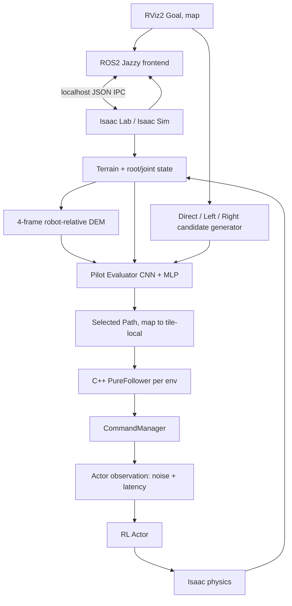

# EAT-Nav data, Evaluator pilot, and GUI experiment pipeline

## What is runnable today

The GUI demo is an online **inference** pipeline. The current offline
Evaluator preparation/training scripts consume a small, sealed ROS-free P1
crossover; they do not collect fresh independent StateGroups. The existing
checkpoint is a one-StateGroup×one-seed **train-set smoke test** for the
40-step (2 s) common-goal progress label. Its validation/test splits are
empty. A student changing the teacher, inputs, or architecture must version
the dataset, model, checkpoint, and evaluation protocol before drawing
generalization conclusions.



ROS2 transports goals and state visualization. The production ROS follower,
ROS bridge, and external Zenoh router are **not** in the simulator control
path. The router carries the frontend's ROS topics. The actual 20 Hz
simulator loop is in `scripts/eat_nav_demo_isaac.py:main`: root pose →
`PureFollower.step_diagnostic` → `CommandOverride.set` →
`reconcile_command_observation` → `policy.act_inference` → `env.step`.
The next post-physics state is sent to `DemoFrontend.publish_state` in
`scripts/eat_nav_demo_ros_frontend.py`; `/clock`, TF, odometry, DEM, Paths,
scores, and status use simulation stamps.

| Component | Source/API | Input → output | Time/frame |
| --- | --- | --- | --- |
| ROS frontend | `scripts/eat_nav_demo_ros_frontend.py:DemoFrontend` | `/goal_pose` or `/eat_nav/cancel` → validated map goal/Cancel over IPC; simulator state → ROS display topics | Goal stamp within 0.5 s of simulation `/clock`; `map` and `base_link` |
| Terrain/state | `demo_isaac_env_cfg.py:EATTerrainGenerator/EATTerrainImporter` | seed, type, row → mesh, tile SHA, origin, robot state | world/map frame; selected row held fixed on reset |
| DEM | `scripts/eat_nav_demo_isaac.py:dem_from_sensor`, `dem.py:robot_dem` | raycaster → `[4,2,20,20]` history | robot-base-yaw, 0.1 m/cell; four chronological frames at 250 ms intervals; actual sensor update stamp is recorded separately |
| Path bank | `demo_contract.py:candidates_for_goal` | current map pose + map goal + frozen bank → `[K,8,2]` robot-local candidates and map Paths | current pre-Path pose; 0.75 m local radius, Direct/Left +20°/Right −20° |
| Evaluator | `evaluator/inference.py:Evaluator.predict` | DEM, pre-noise state, Paths, mask → scores `[B,K]` | pre-Path input; larger predicted 2 s progress is better |
| Follower | `p1_follower_core.py:PureFollower` | selected tile-local Path + tile-local pose + logical time → `[vx,vy,wz]` and diagnostics | one call per 50 ms control step; one instance for the selected Path |
| Command/Actor | `phase_c_sim.py:CommandOverride`, `p1_g3_rosfree_control.py:reconcile_command_observation` | follower command → observed command after noise/latency → Actor action `[B,6]` | body velocity command; Actor observation `[B,22]`, Critic `[B,267]` |
| Physics/log | `scripts/eat_nav_demo_isaac.py` | action → next robot state, reward, done, trace | 50 ms control boundary; new trace row after physics |

### Evaluator input and checkpoint contract

| Tensor | Raw shape | Meaning |
| --- | --- | --- |
| DEM | `[B,4,2,20,20]` | four frames; height relative to scalar reference and binary valid mask |
| Actor state | `[B,22]` | **pre-Path, pre-noise** Actor observation; not Critic or future state |
| Candidate Paths | `[B,K,8,2]` | robot-base-yaw XY in metres |
| Candidate mask | `[B,K]` | Boolean validity; all invalid fails closed |
| Scores | `[B,K]` | predicted teacher units; highest is selected |

`evaluator/preprocessing.py:prepare_inputs` turns four DEM frames into eight
channels for the CNN; it does not encode the image with a plain MLP. The model
in `evaluator/model.py:BaselineEvaluator` has a three-layer convolutional DEM
encoder, separate Path and state MLPs, and an MLP fusion head. The saved
train-only normalization and label transform are part of the checkpoint.
`evaluator/inference.py:load_checkpoint` checks schema, input dimensions,
label type, dataset SHA, and normalization. The GUI additionally pins
checkpoint SHA and `common_goal_progress` label.

The old P1 stored Path `map_xy` is tile-local. `evaluator/dataset.py` subtracts
the tile origin and applies `body_local_path` with the pre-Path root yaw.
During the GUI demo, `candidates_for_goal` creates robot-local paths from
the frozen bank and transforms them into map Paths; the selected Path is
converted back to tile-local for the C++ follower. No post-Path outcome enters
the Evaluator input. The current demo logs the selected candidate and scores,
but its `trace.jsonl` is **not** automatically a new teacher dataset.

## Existing offline preparation and training commands

These are the implemented scripts and their historical source roots. Use a
Python environment satisfying `pyproject.toml` (`Python 3.10–3.12`,
`torch>=2.3`, `numpy<2`, and the listed packages); the simulator container's
`/isaac-sim/python.sh` has Python 3.11/PyTorch 2.7. Create new output paths;
never write into the sealed source roots or the existing pilot checkpoint.
Running the training command makes a **new train-only pilot**, not a
validated model.

```bash
PYTHONPATH=src:scripts /isaac-sim/python.sh scripts/eat_nav_baseline_prepare.py \
  --source crossover \
  --root /home/kojima/lib/onix_isaac_lab/.eatnav-p1-g3-rosfree-crossover-v1-attempt-1 \
  --root /home/kojima/lib/onix_isaac_lab/.eatnav-p1-g3-rosfree-crossover-v1-attempt-2 \
  --root /home/kojima/lib/onix_isaac_lab/.eatnav-p1-g3-rosfree-crossover-v1-attempt-3 \
  --output /path/to/new/crossover-dataset
PYTHONPATH=src:scripts /isaac-sim/python.sh scripts/eat_nav_baseline_train.py \
  --dataset /path/to/new/crossover-dataset \
  --config config/eat_nav/baseline_evaluator_pilot.json \
  --output /path/to/new/pilot-train
PYTHONPATH=src:scripts /isaac-sim/python.sh scripts/eat_nav_baseline_evaluate.py \
  --dataset /path/to/new/crossover-dataset \
  --checkpoint /path/to/new/pilot-train/checkpoint.pt \
  --output /path/to/new/ranking.json
```

The commands above are **script interfaces**, not a newly executed training
run in this handoff. `/isaac-sim/python.sh` is inside the container; an
equivalent compatible host interpreter can be used if it can access the
source roots. The source roots may need bind mounts or a host path adjustment.
Verify their existence before running. The [baseline pilot guide](baseline-evaluator-student-readme.md)
and the existing persistent dataset/checkpoint under
`/home/kojima/eatnav-experiments/baseline-evaluator-pilot-20261013/`
record the actual prior run.

| Stage | Implemented source, input → output | Validation/failure check |
| --- | --- | --- |
| Candidate execution | `scripts/eat_nav_p1_g3_rosfree_sim.py` and its historical manifests: pre-Path state/Path/seed → sealed trace and outcome | The old 12-trial crossover is one independent StateGroup×seed; it is not a general collector |
| Label calculation | `evaluator/labels.py:labels_from_trace`: 40 observed 50 ms rows → four label slots and masks | Requires same-episode complete 2 s; failure/censor remains explicit |
| Dataset | `scripts/eat_nav_baseline_prepare.py`, `evaluator/dataset.py`: three sealed crossover periods → `samples.npz`, `metadata.json` | Verifies seals, Path assignment, pre-Path equality, DEM SHA, and group split; 12 samples, train only |
| Training | `scripts/eat_nav_baseline_train.py`, `config/eat_nav/baseline_evaluator_pilot.json` → `checkpoint.pt`, `result.json` | Checks dataset SHA, group split, normalization from train only, finite loss; no independent validation |
| Offline ranking | `scripts/eat_nav_baseline_evaluate.py` → ranking JSON | Train-set diagnostic only; check source and checkpoint SHA |
| GUI inference | `eat_nav_demo_launch.py`, `eat_nav_demo_isaac.py`, ROS frontend → new trace, score, GUI/ROS topics | Check input SHA, `startup-ready.json`, `complete.json`, `failure.json`, host seal, finite Actor/action, physical root motion |

Labels currently defined in `evaluator/labels.py` are negative normalized
motion residual, common-goal progress, accumulated observed RL reward, and
negative Pain. Motion residual compares executed forward/yaw motion to the
follower command. Reward sums the observed per-step reward over the fixed
window (γ=1 in the pilot). Pain is unavailable without versioned joint/body
allowables, weights, and engineering provenance; raw simulated torque and
contact are not themselves a validated Pain label. The current checkpoint
uses **only common-goal progress**. Motion residual, reward, and Pain are
research alternatives, not trained heads in the current checkpoint.

## What must be built for a research dataset

The existing adapter deliberately requires exactly one independent
StateGroup×seed and train-only split. Before a general Evaluator experiment,
collect additional independent StateGroups/terrain seeds with paired Path
conditions; version the collector and dataset adapter; split by independent
group so siblings never cross train/validation/test; compute labels from
sealed full traces; fit normalization on train only; select checkpoints on
held-out validation; evaluate on untouched test terrain/seeds. The current
demo's short, selected-Path-only trace does not contain counterfactual
outcomes for unselected Paths. No script in this handoff automatically
creates that broader dataset or trains a generalizable Evaluator.
