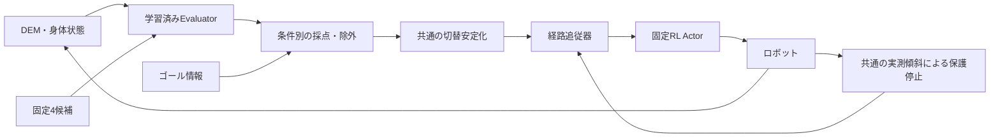

# 既存学習済みEvaluatorのK-Railリスク回避比較仕様 v0.1

作成日: 2026-10-23 JST。状態: **レビュー用仕様案。実装・新規走行は未実施。**

利用者と教授の方針に沿い、追加収集を先行させず、既存データで学習済みのEvaluatorを用いて、リスク評価が経路選択と走行結果に役立つかを確認する。
初回の実施範囲は3 development seed × 3条件、各最大90秒の計9走行とする。この比較報告を一区切りにし、陽性seed数の充足を待って自動的に収集を続けない。

## 1. 目的と位置付け

確認する問い:

1. スタックリスクの反映で、リスクを反映しない場合より進みやすい候補を選べるか。
2. スタック回避に伴い、大きな傾斜や実姿勢による保護停止も減る傾向があるか。
3. 転倒・near-fall予測をさらに反映する利点、または過剰停止・進捗悪化があるか。

「固定RL Actorが踏ん張るため、転倒せず進めなくなる」という説明は仮説として扱う。
スタック回避と傾斜・保護停止の変化は調べるが、Actorを固定する本比較だけでRLが転倒を防いだという因果関係は断定しない。

Evaluatorは候補経路の生成後、経路追従器に渡す経路を選択する位置に置く。
今回扱うのは既存4候補を用いた閉ループの開発比較であり、既存ナビゲーション全体への正式統合、正式held-out test、実機評価は別段階である。

## 2. 現状と今回の対象外

- [既存データでの28次元Evaluator学習](command-free-learning-20261021/learning-report.md)は完了済み。train24 / validation8 base seed、計128 StateGroup・512候補を使用した。
- [教師化済み累積データ](additional-development-batch02-cumulative-20261021/dataset-report.md)の陽性base seed数はtrain / validation順に転倒10/1、near-fall7/1、直進スタック8/4、旋回スタック2/1。これを学習着手の追加待機条件にしない。
- [2026-10-22のGUI比較](risk-guard-gui-20261022/comparison-report.md)は切替ルール等も変更しており、リスク項だけの比較ではなかった。今回の比較条件は全て新たに実行する。
- 同GUIで最大傾斜54.58→23.98度、候補変更6→2回、最終goal距離2.94→1.97mだったが、STOPは作動しなかった。この結果は背景情報として保持し、今回の9走行へ合算しない。
- batch01/02収集は完了。batch03はprotocol/manifest固定までで実行時binding・収集は未実施。今回開始しない。
- 今回は重み・正規化・教師・dataset・Actorを更新しない。地形難化、その場旋回候補の追加、外力、転倒を誘発する初期化も行わない。
- GUIで新規の物理走行を表示する。リプレイを走行と扱わない。

## 3. 固定する学習済みモデルと実行要素

| 要素 | 固定値 |
|---|---|
| Evaluator | command-free v2、DEM＋State＋candidate、optimization seed123、epoch159 |
| checkpoint | `docs/eat-nav/command-free-learning-20261021/artifacts/dem_state_candidate-seed123/checkpoint.pt` |
| checkpoint SHA256 | `7e6b6af0f56d63c76dce7d9a52cc00a02b95b32f587449a2e32ab079ff9812d1` |
| 学習artifact ledger SHA256 | `6e3694d43a9e078b830d8600c9bc6b11e8e1d2895ea4aa413231120a3710ddb9` |
| Actor checkpoint | `checkpoints/eat_nav/rl_actor/model_10000.pt` |
| Actor SHA256 | `b789f3ab4820a62fffeaaf5a600e5a1479cc624240e5d027772bb3fee8d51a3d` |
| Evaluator入力 | DEM4 frame・mask、Actor22値のindex6/7/8を除く19値＋body9値、候補path・direction |
| 実Actor観測 | 元の22値と既存遅延・noiseを保持。Evaluatorから除外した速度司令を実Actorから除外しない |
| event予測 | 10秒のtip / near / linear / turn、保存済みcheckpointの出力を使用 |
| progress予測 | 同じモデルの10秒progress、全比較条件で共通 |

4候補の固定順は `forward_direct`、`forward_-30`、`forward_+30`、`reverse_direct`。
body座標の経路は既存bankの弧長0.75m・8点をそのまま使用する。その場旋回は含まれない。
候補が増える別protocolを今回へ混在させない。

既存学習は同じ候補を継続した将来outcomeを対象とする。2秒ごとに候補を切り替える今回の閉ループは、その学習条件と完全には一致しない。
予測を校正済み確率・保証付き安全制約と扱わない。

## 4. 比較する3条件

全条件で同じモデルを推論する。A0もprogress予測を使うため、「Evaluator全体を使わない比較」とは呼ばない。

| ID | 名称 | scoreから引くrisk項 | 予測による候補除外 |
|---|---|---|---|
| A0 | リスク項なし | 0 | なし |
| A1 | スタックのみ | `1.0*p_linear + 0.5*p_turn` | stall条件のみ |
| A2 | 転倒＋スタック | `2.0*p_tip + 0.5*p_near + 1.0*p_linear + 0.5*p_turn` | stall条件、およびtip/near条件 |

候補iの共通goal progress proxyは、body座標goalをg、経路endpoint方向単位ベクトルをu_i、予測progressをq_iとして、
`G_i = ||g|| - ||g - u_i * clip(q_i, 0, 10m)||` とする。`score_i = G_i - risk_i`。
これはgoal距離減少の近似値であり、予測到達位置や走破保証ではない。同点は固定候補順を優先する。

予測による除外・再開条件:

- stall条件: `(p_linear >= 0.95 OR p_turn >= 0.95) AND q_i <= 0.05m`。A1/A2でのみ使用。
- tip/near条件: `p_tip >= 0.7 OR p_near >= 0.7`。A2でのみ使用。
- A1の予測STOPからの再開候補: stall除外に該当しない候補。
- A2の予測STOPからの再開候補: stall除外に該当せず、tip/nearともに0.5未満の候補。
- 全候補がその条件で除外されたらSTOP。危険候補へのfallbackはしない。
- 除外されない候補のscoreを比較する。無効headを重み0にしただけで、除外や再開判定にそのheadが残る実装は禁止する。

A1−A0はスタック項の採点・除外・予測STOPの総合効果、A2−A1は転倒/near項の追加効果を比較する。
個々のheadの精度やscore penalty単独の因果効果を分離する実験ではない。

## 5. 全条件共通の追従・切替・実姿勢保護

[既存guard仕様](risk-guard-spec-v0.1.md)の通常切替を全条件で共通化する。

- 20Hz制御、40 step（2秒）ごとに候補を再評価する。
- 通常は選択後80 step（4秒）保持し、別候補がscoreで0.15以上上回る場合のみ変更する。
- 前進/後退の変更は、上記の保持・差分条件を満たす方向が2回連続で優位な場合に行う。
- 現候補が有効なrisk条件で除外されたら、保持・差分・方向確認を待たず残る候補へ変更する。A0には予測によるoverrideがない。この差もrisk機能の一部として記録する。
- 全条件で、同じタイミングの再評価時に新しいPureFollowerを作る。候補が変わらない場合も従来と同じ更新方法を用いる。

実姿勢保護は全条件で有効とする。

- 実測tilt45度以上を20Hzで検出したら即座にSTOPへ移る。
- STOPからの再開には、最低40 step停止し、tilt35度以下と再開可能候補ありを2秒判定で2回連続確認する。
- A0の再開判定に予測riskを使わない。A1/A2は節4の条件を加える。実姿勢STOPと予測STOPが重なった場合は両理由を保持し、上記の全条件を満たしてから再開する。
- STOPでは注入指令(vx,vy,w)を全て0とし、PureFollowerを進めない。物理・Actor・観測は継続し、既存の指令/観測遅延は保持する。再開時はfollowerを作り直す。
- 不正な入力・予測、GUI close、実行期限超過は成功として扱わず、別の終了理由で保存する。

STOP原因は単一文字列の上書きで管理しない。各STOP episodeの`episode_causes`に発生した原因を再開まで保持し、各stepの新たなtrip原因と再開を妨げている条件（tilt、候補なし、最低停止時間、連続確認不足）を別フィールドへ保存する。
予測判定ごとに4候補×stall/tip/nearの除外根拠と最終maskを保存する。異なる原因で各候補が除外される混合ケースも「全候補除外」に含める。
原因別時間はその時点のblockerを基準とし、episode内に一度発生した原因を以後の全時間へ引き延ばさない。原因別時間は重複し得るため足し合わせず、STOP総時間はintervalの和集合で数える。

**解釈上の制限:** 共通保護が実際の転倒を抑制し得る。転倒0件だけで学習済みriskが有効とは結論しない。
実姿勢STOPは「保護介入」として全条件で数え、予測STOPと分ける。停止による未到達を回避成功と数えない。

## 6. 走行条件・事前割当て・実施上限

初回は以下の9走行を実施する。1走行につき新しい環境を起動・初期化し、条件間でロボット状態・履歴・guard状態を引き継がない。

| case | development base seed | 条件の実行順 |
|---|---:|---|
| D0 | 2191202837 | A0 → A1 → A2 |
| D1 | 3777004980 | A1 → A2 → A0 |
| D2 | 1710704769 | A2 → A0 → A1 |

- D0は既に観察済みの開発seed。D1/D2も本比較で開発用となり、正式testや将来の未使用評価へ戻さない。
- D1/D2はtoken `eatnav-krail-risk-ablation-development-20261023|0` / `|1` のUTF-8 SHA256の先頭4 byteをbig-endian整数として導出した。
- 照合元は `fall-stall-additional-batch03-freeze-20261021/artifacts/seed-registry.json`、SHA256 `5de2f877ee66bebf513611ce5db204c6021618def699ffa8c5a4c0b4cdafd4ea`。
- registryのgroupsとknown_exclusions、およびD0からbase seed集合を作り、各seedの `SeedSequence([base, stream, index])` の最初のuint32をstream0..2・index0..19で保守的に照合した。D1/D2間も含めbase/派生seed重複なし。実行manifest作成時にこのmetadata検証を再現する。reserved testのraw・ラベルを使わない。

共通条件はK-Rail `k_rail_step_field` level4、front-folded、1env、既存Actor env config、20Hz。
既存GUIと同じdemo reset policy（`time_out`無効、`tilt_over`有効）を使用する。既存の`episode_length_s=40`だけで90秒以前にtime-out終了させず、他の終了条件の有効/無効も既存設定と照合してmanifestに記録する。
既存GUIと同じ20 stepのzero指令によるsettling・DEM履歴取得を行い、その後のposeを開始点として前方4mをgoalとする。
各seed内3条件で地形、初期化乱数、設定を揃える。開始poseと全初期入力はatol1e-6・rtol0で照合し、不一致の組は比較不成立と報告する。
制御が分岐した後の入力・noise系列の完全一致やGPU物理の完全決定性は保証しない。

走行上限は1800 step（90秒）。goal半径0.25m、自然termination、GUI close、実行エラー、上限のいずれかで終了する。
goal到達は開始時と各step後に検出し、最終1800番目のintervalも対象とする。自然termination時はreset前snapshotを使う。
同じstepにgoal進入と自然terminationが発生したら、幾何学的な`goal_entered`と初回時刻を保存する一方、終了理由はnatural terminationを優先する。正常到達成功は`goal_entered`かつ同stepに自然failureなしの場合とし、転倒しながらgoal範囲へ入った場合を正常成功に数えない。
到達時間はsettling終了からのpost-state時刻で計算する。goal到達・自然terminationが上限と同時なら、それらを単なるhorizon完了に置換しない。
STOPや停滞だけを理由に早期終了しない。最大15 decisionだった旧30秒比較と新90秒結果をそのまま条件差として比較しない。
物理終了後はpauseして60秒GUIを表示する。シミュレーション90秒とwall timeを分け、起動・描画時間込みのcontainer側wall timeoutは `420 + 90 + 60 = 570秒`、INT後の強制終了猶予20秒、host監視猶予40秒を事前manifestに固定する。timeoutが発生した走行は90秒完走として扱わない。

実装/起動不具合は原因・失敗attemptを保存し、各case×条件につき最大1回だけ修正後の再試行を認める。全体は初回9＋再試行最大9＝18 attemptを上限とする。上限に達したcaseは失敗のまま報告し、代替seedを追加しない。完了済み走行の結果が悪いことを理由に再試行しない。失敗した走行を消さず、同じcaseの都合のよい結果を選ばない。
モデル・条件式・物理・初期化に変更が必要なら新revisionとし、影響する比較組を揃えて実行する。revision変更でattempt上限を自動更新せず、揃えられない場合は比較不成立とする。9走行後に陽性不足を理由とする自動増枠は行わない。

## 7. 観測と評価指標

全seed・全条件の結果を行単位で提示し、同seedのA1−A0、A2−A1、A2−A0の差分を併記する。
3 seedのため記述的比較とし、有意差・事故率の母集団推定・未知地形一般化を主張しない。

| 指標 | 定義と扱い |
|---|---|
| 正常goal到達 | 節6の正常到達成功を数え、成功数/比較成立case数と全予定case数を併記。幾何学的な`goal_entered`は別に報告 |
| 到達時間 | 正常到達成功の走行のみ。`goal_entered`時刻は別記。未到達を90秒到達として平均しない |
| 最終goal距離・進捗 | 最終距離と`4m−最終距離`。自然reset時はreset前状態を用いる |
| 並進停滞 | 教師v2の40 interval定義を満たすwindow数・時間。判定可能時間も併記 |
| 旋回応答不足 | 教師v2の指令/角速度条件によるwindow数・判定可能時間。並進できる場合もある |
| 姿勢 | 最大tilt、60度以上の連続長、教師v2のnear-fall/転倒を観測可能な範囲で記録 |
| 保護介入 | 実姿勢STOP開始回数・時間、初回時刻、予測STOPと重なった時間 |
| 予測STOP | stall / tip / near別の根拠・開始回数・時間。複数理由の重複を保持 |
| 追従と切替 | 候補変更、前進/後退変更、再開回数、override回数、選択score差 |
| STOP中の実挙動 | 全3軸注入指令、Actorが見た指令、実速度・水平移動。0指令と静止を区別 |
| 実行整合性 | horizon/goal/自然termination/close/失敗の理由、初期条件照合、source/checkpoint SHA |

教師v2定義は[転倒・スタック学習仕様](fall-stall-learning-spec-v0.1.md)節4を参照する。
並進/旋回windowは重複しない40 intervalで、十分な信号が揃う区間のみ判定する。STOPや途中の保護介入・候補変更を含み、固定cycleの前提を満たさないwindowはunknownとして別集計する。
unknownや未走行区間を陰性にしない。2秒window数を独立事故件数と扱わない。

全体時間の内訳は各headについて、(1)STOP interval、(2)STOPを含まない完全な判定可能windowに属するrunning interval、(3)それ以外のrunning interval、に排他的に分け、実走行時間へ一致させる。
STOP混在windowは教師判定上unknownだが、その中のSTOP時間を(3)にも重複計上しない。linear/turnの判定可能時間と陽性時間は別々に算出する。
信号が揃ったrunning windowで必要な指令量・連続旋回指令等を満たさない場合は、教師v2どおり観測済み陰性とする。指令が小さいだけでunknownへ移さない。
STOP時間と、(2)のうちstall陽性だった時間を別に提示する。STOPでstall windowが減っただけの場合は停滞改善と結論しない。

## 8. 候補の有無・機序の診断

リスクにより選択が変わったdecisionでは、同じ保存入力上でA0/A1/A2の採点・除外を再計算する。
これは同じ状態での**選択差の診断**であり、選ばなかった候補を実際に走った結果やcounterfactual教師ではない。
切替の履歴に依存する最終選択は各条件のguard履歴付きで再現し、別条件の履歴を捏造しない。

選択が変わった前後、STOP開始、stall、最大傾斜付近のDEM・候補経路・実軌跡をreviewする。
「候補bankに迂回方向が見当たらない」「迂回らしい候補があるが選択しない」「選択するが追従できない」を診断として分け、根拠と不確実性を記録する。
地形図・DEM上で空いて見えるだけで走破可能と確定しない。選ばなかった経路の走破性は原則未確認である。

迂回候補の存在を事後に証明できないcaseも除外せず全件報告する。
全caseで選択の差がない、十分なrisk差がない、または迂回の選択肢がない場合は「本比較では回避能力を判定する場面が不足」とする。モデル無効とは直結させない。

## 9. 保存物・GUI・再現性

実装時は新規scriptと新規専用出力先を使用し、過去sealed成果物・収集binding対象sourceを変更しない。
仕様、9走行manifest、seed検証、全比較条件、checkpoint/Actor/config/source SHAとruntime情報を走行前に記録する。

保存物:

- 各decisionのDEM・mask・stamp、raw Actor/body状態、path/direction、全4候補予測、goal、条件別score/除外根拠。
- 全20Hz stepのpre/post root状態、goal距離、実選択・STOP、注入/Actor指令、guard状態、追従器diagnostic、reset前termination snapshot。
- 学習用教師への再利用を検討できるよう、cycle境界・候補切替・観測区間を明示する。ただし今回のログを既存固定10秒candidate教師へ自動追加しない。
- GUIにcase/条件、実時間ではなくsim時刻、選択候補、risk・progress、goal距離、STOP理由を表示。起動時にhostコマンドと実際のDocker/Isaacコマンドを表示・保存する。
- 全caseの要約、paired差分、時間推移図、実画面、選択再現監査、失敗・unknown一覧、sourceと成果物のseal。

全条件で推論を行い、使用するheadだけを採点・除外から切り替える。A0/A1で無効なheadが選択・STOP・再開に影響しないことをテストする。
STOPの全3軸0、follower不進行、再開条件、通常切替の共通性、90秒上限、初期入力照合、reset前状態、全STOP走行の有効保存を検証する。
保存入力から予測・score・mask・guard状態・選択を再現し、過去source/学習artifactの整合性も照合する。

## 10. 比較の終了と次段階の判断

9走行の実施・失敗を全て説明でき、比較成立caseと観測不能部分を含む報告を完成させた時点で、この開発比較を終了する。
以下の判断は事前に定めた読み方であり、3 seedでの正式な性能合格基準ではない。

- 到達数が増える場合は有望とする。同数ならgoal進捗・到達時間・動作中stall・保護介入を併せて判断する。傾斜低下だけを成功にしない。
- A1で進捗が改善し保護介入も減るなら、スタック回避による危険箇所回避の仮説と整合する傾向として報告する。
- A2の上乗せが小さい/悪化する場合も記録し、転倒データ不足だけを即座に原因と決めない。予測、重み/閾値、候補、追従、初期状態のどこで差が出たかをreviewする。
- STOP増加によりgoal進捗が落ちるなら、保守化と走行性能のトレードオフを示す。停止したため転倒0という結果を回避走行成功と扱わない。
- 有望な場合は、Evaluatorの正式な候補経路選択への統合と別development条件での確認を次段階にする。今回同じ9走行を見ながら閾値を調整しない。
- 予測が外れる地形・身体状態が具体的に見えた場合に、その条件のデータ追加→教師化→再学習を検討する。候補不足なら候補設計、追従不能なら追従/Actor側を先に検討する。
- 対象条件が不足して判断できない場合は、その不足を報告し、次に必要な小規模比較を別revisionで定める。

転倒陽性の最低coverage達成、batch03実行、その場旋回の追加を、本仕様の実施・終了やEvaluator統合を検討するための一律の前提条件にはしない。

## 11. 承認後の実装順

1. 条件別のscore・除外・再開と共通切替/実姿勢保護を新規実装し、上記の回帰テストを行う。
2. seed・source・初期化・9走行のmanifestと実行bindingを固定する。reserved testはmetadata照合以外に開かない。
3. 上記の順序でGUI走行を行い、終了理由・失敗を保持する。
4. 全条件の比較報告とログ再現監査を作成し、節10に基づいて次の判断を行う。

初回の予算（3 seed、90秒、9走行）、3条件の比較、共通45度保護は、本仕様作成時の提案値である。
この仕様案の承認をもって実装対象として固定する。本ファイル作成だけで新規収集・再学習・GUI走行が実施済みとはしない。
