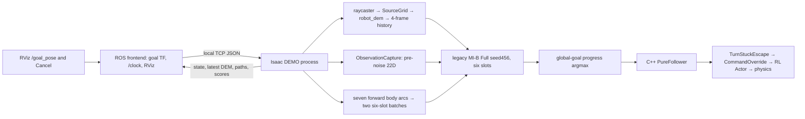
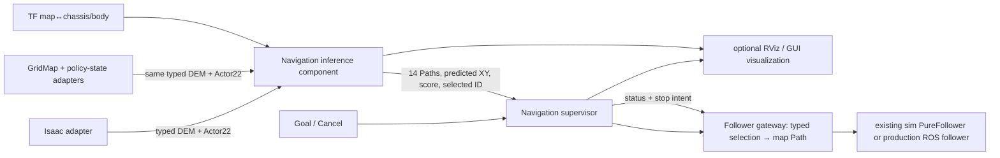

# EAT-Nav ROS2 node separation and input adapter — Phase 1 design review

Status: **design for review; no implementation or runtime authorization**.  Base commit: `0e74f6746006aef55ed9b6c54943d5940b82dea2`.  The Stage B/C worktree, frozen manifests, jobs, checkpoints and evidence are outside this design worktree and remain unchanged.

**レビュー要約:** 推奨構成は「シミュレータ／実機の入力Adapter、入力履歴＋14候補推論、Supervisor＋Follower gateway、任意のGUI」の4プロセス群です。学習時と同じ4-frame DEM、pre-noise 22D状態、固定順序の14候補をモデル直前で検証します。実機GridMapの実配置・更新周期、effortの意味、実機Followerの停止保証は未確認であり、これらを確認せず実機へ接続しません。

## 1. Purpose and scope

The proposed ROS2 boundary must reproduce the Stage B/C Motion Predictor input **immediately before model inference**, including numerical values, ordering, frames and time. It must allow the navigation pipeline to run without a GUI. Phase 1 creates this design only. Phase 2 requires review approval; Phase 3 additionally requires both Stage B and Stage C to finish and separate Isaac runtime approval.

This is a new ROS integration protocol. It does not change the 14-Path bank, Stage B DEM conversion, 22D Actor observation, two-second target, Stage C training or adoption gate, RL Actor, or either follower control law.

## 2. Current architecture and source inventory

`scripts/eat_nav_demo_launch.py:50-135` stages and starts the two processes. `scripts/eat_nav_demo_isaac.py:327-378` owns capture, inference, follower, command injection and physics; `scripts/eat_nav_demo_ros_frontend.py:42-62,160-195` handles ROS goal ingress and visualization. The frontend publishes **only the latest** DEM frame and an **unstamped** `Float32MultiArray` Actor vector. These are not currently ROS inference inputs. The GUI can be omitted from the intended new navigation process, but the present demo still puts navigation inside Isaac.

Stage B separately captures raycaster world hits, uses `robot_dem`, records four frames at 250/500/750/1000 ms, stores `actor_pre_noise`, activates one of the frozen 14 Paths, and executes the C++ `PureFollower` for 40 steps (`scripts/eat_nav_motion_14_collection_sim.py:93-105,158-172,298-339,365-419`). Stage C's pipeline waits for all 1152 processes before dataset building and training (`scripts/eat_nav_motion_14_pipeline.py:24-55`). Its new checkpoint is not available at Phase 1 review time.

The proposed real source is `/elevation_map` with `map` and `chassis/body`, nominal 2 × 2 m at 0.1 m (`onix_automation/config/elevation_mapping.onix2.yaml:107-124`). The real launch starts `simple_trajectory_follower_node` (`onix2_elevation_navigation.launch.py:259-261`). The local `onix_policy_bridge.py` subscribes to `JointState`, `Imu` and `Twist` and reconstructs an RL observation. Its `_build_observation()` at lines 596-623 does **not visibly append `flipper_fold_mode`**, although the resolved Isaac policy does (`rough_env_cfg.py:475-479`). This is a source-level discrepancy to test; no missing component may be silently filled with zero.

## 3. Architecture choices

| Approach | Benefit | Cost/risk |
|---|---|---|
| Eight independent ROS processes | Maximum process separation | More serialization, timestamp joins and failure modes on the 20 Hz path |
| **Recommended: source adapters + one inference component + supervisor/gateway + optional UI** | Same adapter and predictor for Isaac/real; one atomic tensor assembly; UI independent | Requires typed messages and explicit gateway state machine |
| One monolithic ROS node | Lowest transport delay | Keeps acquisition, inference, control and UI coupled |

Logical roles remain eight; proposed deployment is four process groups: (1) one selected source adapter, (2) the navigation inference component, (3) supervisor and follower gateway in one process with separate modules, and (4) optional UI. Supervisor/gateway may be split later without changing their typed contract.

The Isaac and real source adapters are alternatives. The inference component owns the four-frame assembler, frozen bank, strict checkpoint loader, model and global-goal scorer in one process. A separate supervisor owns Goal/Cancel/Timeout, replanning and turn-stuck state. The follower gateway owns Path frame conversion, direction validation, publication and the **command safety gate** downstream of the follower. It does not implement a new follower. The GUI subscribes to telemetry and never owns navigation state. If the GUI process exits, navigation continues.

## 4. ROS2 wire contract proposal

All custom messages below are versioned under a proposed `eat_nav_interfaces` package in an isolated Phase 2 workspace. Their field names are proposed, not implemented. `/clock` is simulation-only; the real adapter uses one consistent ROS clock domain. Reliable control delivery does not establish numerical parity by itself: the receiving node must validate stamps, sequence and hashes.

| Flow | Proposed type and key fields | Frame, stamp, rate, QoS | Invalid/missing behavior |
|---|---|---|---|
| Source → inference DEM | `DemFrame`: `Header`, `sensor_stamp`, `episode_id`, `float32[400] height_m`, `uint8[400] valid`, `resolution_m`, `preprocess_id`, `source_id` | Header = pose/transform time; `chassis/body` robot-relative raster; 4 Hz; reliable, volatile, keep-last 8 | Reject malformed grid, mask, stale/future stamp or discontinuity; clear history on episode change |
| Source → inference Actor | `ActorState22`: `Header`, `episode_id`, `float32[22] value`, IMU/joint/command source stamps, observation contract ID | `chassis/body`, policy observation time; 20 Hz; reliable, volatile, keep-last 8 | Reject missing source fields, stale/future or wrong contract; never zero-fill unavailable effort |
| Goal ingress | `geometry_msgs/PoseStamped` on `/goal_pose`; `std_msgs/Empty` on `/eat_nav/cancel` for current UI compatibility | Goal stamp required; frame transformed to `map` at its stamp; reliable, volatile, keep-last 1 | Reject TF failure, stale/future goal; Cancel increments goal generation and stops publication |
| Inference → supervisor | `CandidateEvaluation`: header, goal generation, bank/checkpoint/normalization IDs, 14 fixed IDs, direction, 8-point body Paths, mask, predicted body XY, global-goal scores, chosen index | Acquisition/inference anchor stamp, `chassis/body`; one per valid replan; reliable, volatile, keep-last 1 | Supervisor rejects old generation, expired anchor, nonfinite prediction or mismatch |
| Supervisor → follower gateway | `PathSelection`: header, generation, candidate ID/index, `int8 direction`, bank/path SHA, 8 body points, expiry | Body-frame points at selection pose stamp; reliable, volatile, keep-last 1 | Reject duplicate/out-of-order selection or unknown Path SHA |
| Gateway → existing follower | `nav_msgs/Path` in `map` for real follower; direct tile-local Path construction for Isaac PureFollower | Transform at selection stamp, never latest-TF fallback. Match existing follower's topic/QoS; do not transiently replay a stale selected Path on restart | On disconnect/expiry, enter stop state; require fresh selection after reconnection |
| Status and display | `NavigationStatus` plus `MarkerArray`, optional 14 candidate `Path` views, selected `Path`, DEM images | Status reliable/volatile; images/markers best-effort/volatile; visualization must not feed predictor | UI loss has no control effect; diagnostics record cause and source stamps |

`nav_msgs/Path` does not carry candidate direction, mask, bank order or model provenance; a typed selection message is required before the gateway. The production follower infers reverse travel from the initial tangent (`bidirectional_bank.py:27-49`); the gateway must also verify that its computed initial tangent agrees with explicit direction. It must not change the production follower. Its existing `nav_msgs/Path` subscription uses transient-local QoS (`simple_trajectory_follower.cpp:129-134`), so the Phase 2 gateway must prove that an old Path cannot resume after Cancel/timeout/restart. Until that stop contract is verified, the real follower remains disconnected in tests.

Two Path digests are distinct: `bank_source_sha256` identifies the frozen float64 geometric bank/source, while `wire_path_sha256` identifies the serialized float32 `[8,2]` Path delivered to the model/gateway. The gateway compares each to the corresponding frozen value; it never compares float64 and float32 bytes as if they were identical.

## 5. Model tensor and adapter contract

| Model input | Source message → deterministic operation | Exact requirement |
|---|---|---|
| DEM `[B,4,2,20,20]` | Four `DemFrame` messages oldest→newest; height then mask; apply checkpoint train-only valid-height normalization only immediately before inference | Each frame is robot-relative at **its own** acquisition/pose time. Never reproject older frames into current body frame. Negative heights survive. Invalid height is zero, mask remains 0/1. No per-frame min-max scaling. |
| Actor `[B,22]` | `ActorState22` at newest DEM anchor; apply checkpoint `state_mean/std` immediately before inference | **Pre-noise**, after policy term clipping/scaling. Do not use Actor post-noise or post-delay values. Source fields have explicit units, signs, source stamps. |
| Path `[B,14,8,2]` | Generate with `bidirectional_bank.bank()`; cast to float32 only at model boundary | Body-frame metres; origin waypoint included, 0.75 m arc length; fixed IDs/order; never rotate toward goal. |
| Direction `[B,14,1]` / mask `[B,14]` | Bank directions `[+1]×7 + [−1]×7`; complete mask for the trained 14-candidate model | Direction and point tangent checked separately. Missing candidate is a failed 14-bank input, not a shifted slot. |
| Predicted motion `[B,14,2]` | Strict checkpoint load → model → inverse target normalization | Body-frame XY metres at 2 s, goal independent. Yaw, contact, load and long-term success are not model outputs. |

The concrete bank is `eatnav_forward_reverse_path_bank_v1`, angles `(0,-30,+30,-60,+60,-90,+90)` for each direction, 8 equally spaced arc-length points from 0 to 0.75 m (`src/visualnav_transformer/eat_nav/bidirectional_bank.py:11-54`). The current GUI bank contains only the seven forward Paths (`demo_arc_candidates.py:12-38`). Its old six-slot model evaluates seven Paths in two batches and only forward direction (`demo_motion_predictor.py:32-60`). The 14-bank and old checkpoint are therefore distinct explicit modes. No checkpoint swap or implicit padding/truncation is allowed.

The Actor term contract follows `actor_state_22d_audit.md:3`: body angular velocity `(rad/s)×0.25`, projected gravity components clipped to ±1, body command `(m/s,m/s,rad/s)`, fold mode scalar, RR/RL/FR/FL relative angles `(rad)`, right/left track means `(rad/s)×0.05`, and four flipper plus right/left summed track efforts `(N·m)×0.01`. The exact effort units/sign and real command value must be checked against observed `JointState.effort` and the command accepted by the RL policy. A configured `fold_mode=0` is permissible only when the published RL policy also uses 0; it is configuration state, not a sensor inference. The current local bridge's missing fold-mode append and its use of reception time for JointState/IMU freshness (`onix_policy_bridge.py:500-530,596-623`) are parity blockers until proven otherwise.

The DEM adapter must first map `grid_map_msgs/GridMap` circular storage, axes, cell-centre origin, unknown cells and map frame into `SourceGrid` (`src/visualnav_transformer/eat_nav/dem.py:1-73`). It then calls the unchanged `robot_dem()` with map pose at that frame's stamp. `robot_dem()` resamples into rows body +y/columns body +x, subtracts the median valid height from the 0.3–0.8 m annulus as one scalar, retains negative values, and rejects less than 25% valid cells (`dem.py:76-110`). The production GridMap's actual layout and update frequency have not yet been measured; nominal 2 m/0.1 m configuration alone is insufficient proof of a 20×20 input. Do not silently duplicate frames or change training timing to mask a slow real map.

## 6. Time, TF and Goal scoring

The Stage B anchor has DEM logical stamps `[250,500,750,1000]` ms with the newest DEM and Actor pre-noise captured at 1000 ms (`eat_nav_motion_14_collection_sim.py:158-172`). The simulator raycaster's actual update time is retained separately when exposed (`:124-133`). For each `DemFrame`, distinguish source sensor stamp, pose/transform stamp and publication time. The ROS history assembler uses the four frames at 250 ms spacing in one episode, rejects duplicate/reversed stamps, and clears state on reset. The current demo checks exact 250 ms spacing and newest-frame/Actor equality, with a 300 ms maximum age (`demo_contract.py:82-97`); use these as the simulator parity target. A real sensor's jitter policy and acceptable source age must be frozen before real use based on measured messages, not inferred from nominal configuration.

The inference anchor is the newest DEM/Actor stamp. Look up `map → chassis/body` **at that stamp** to express the global goal in current body coordinates. A simulation `base_link` alias is accepted only after its static/exact transform to `chassis/body` is verified. Evaluate candidate `k` using

`score_k = ||goal_body_xy|| − ||goal_body_xy − predicted_xy_k||`.

Reject masked candidates; argmax ties use the frozen bank order. The score is metres of predicted **two-second global-goal distance reduction**, not a local-arrival or navigation-success prediction (`demo_motion_predictor.py:63-82`; `motion_14_demo_stage_d_contract.json:10-20`). The selected body Path is transformed to map at the selection pose stamp. A stale TF, goal, state or DEM causes **no new Path publication**. The supervisor requests a safe stop through the gateway/command interface; it must prove that the existing follower does not continue an old Path. Never use latest-TF fallback without a separate reviewed protocol.

## 7. Checkpoint and operating modes

The Stage C loader proposed for Phase 2 must fail closed unless it verifies model class/variant `Motion14Predictor/full`, schema, architecture/state-dict shapes, 14 IDs in frozen order, bank version and geometry SHA, DEM/state/path/direction/mask shapes, finite train-only normalization, target inverse normalization, training source/data/config SHA, checkpoint SHA and `demo_adoption.decision == pass`. Stage C code saves candidate count/order and source/normalization and checks them on evaluation (`eat_nav_motion_14_train.py:107-113,264-275`); the ROS loader must additionally bind input/bank schema explicitly. Test data never selects the checkpoint.

Before Stage C adoption passes, the default remains the old MI-B Full seed456 fallback with its **existing seven-forward GUI mode**. The old loader pins a distinct checkpoint SHA and a six-slot `PilotPredictor` (`demo_motion_predictor.py:1-5,107-125`). The selector must report which mode is active. Old-model outputs must never be labelled as 14-candidate model outputs. A mock predictor is allowed for ROS wiring tests only and never for driving-performance claims.

## 8. Supervisor, follower and safety behavior

Supervisor states: `IDLE → WAITING_INPUT → ACTIVE → ARRIVED`, with `CANCELLED`, `STALE_INPUT`, `FOLLOWER_LOST`, `TIMEOUT`, `FALL_RESET` and `ERROR` transitions. Goal generation IDs prevent delayed predictions from reactivating an old goal. Replanning defaults to the current 10 control steps/0.5 s in the sim demo (`eat_nav_demo_launch.py:55`), conditional on a new complete input set. Cancel, timeout, stale data and follower loss invalidate the selected Path and require a tested stop handshake. On a fall reset, clear DEM and Actor history, follower activation and turn-stuck state; accept a new Path only after four fresh frames and a fresh Goal decision. Keep the demo's front-folded reset and fold mode 0; training collection retains StateGroup-level Front/Rear assignment.

The present demo applies `TurnStuckEscape` **after** PureFollower and before CommandOverride (`eat_nav_demo_isaac.py:359-378`); the preprocessing detects low yaw response for 2 s and alternates longitudinal offset every 1 s (`demo_turn_escape.py:24-55`). This belongs to the supervisor/command adapter, not the follower core. Phase 2 can test the state machine offline, but any real actuation requires separate validation. The collection protocol's single Path/40-step target and the demo's replanning/turn escape are different closed-loop conditions. Both simulator demo and Stage B use the same `PureFollower` wrapper/core; the real `simple_trajectory_follower` is a different implementation. Existing command parity is useful reference evidence, not proof of real closed-loop equivalence. Follower unification and control-law changes are outside scope.

The gateway output contract is `Path(map, stamped, eight poses) + expected direction + selection generation`. It verifies body/map round-trip, first tangent, topic and QoS, and reverse interpretation. It observes follower readiness and command/feedback age. The command safety gate is the sole proposed route from follower `cmd_vel` to the policy command input; it passes a fresh follower command only while the supervisor holds a valid Path lease, and otherwise emits zero command at 20 Hz. No follower output may bypass it. In Phase 2 the gateway and safety gate are bound to a **mock robot interface**, never to real velocity topics. The production follower's handling of empty Path, timeout and transient-local retained Path must be reviewed and tested before actual connection; an unproven stop handshake blocks deployment.

### 8.1 DEM delay versus outage — frozen Phase 2 policy

The 250 ms DEM cadence is the learning/input contract. Track both the last **distinct valid sensor update stamp** and the last successful model inference. A duplicate stamp does not refresh either clock. A new quartet is accepted only when its four source frames and Actor/TF pass the same parity and time gates.

| Condition at a 0.5 s replan opportunity | Supervisor decision | Existing Path |
|---|---|---|
| New valid quartet ready; newest sensor update age ≤300 ms | Infer and select | Replace once with new generation; renew 500 ms Path lease |
| No quartet yet; last distinct valid update age ≤300 ms | Normal jitter: defer replan | Continue only while prior 500 ms Path lease and follower/command feedback remain healthy; never republish |
| Update age >300 ms but ≤500 ms | Degraded/missed update: defer and diagnose | Continue only until the **earlier** of the 500 ms Path-lease deadline and 500 ms sensor-age deadline; no new inference |
| Update age >500 ms, Path lease expired, episode changed, or feedback stale | Sensor outage or unsafe state: enter `STALE_INPUT`/`ERROR` | Invalidate Path generation, close command safety gate and request stop; require a fresh four-frame history before resuming |

The 300 ms age is the existing simulator sensor-age gate (`demo_contract.py:25-33`); 500 ms is one current replan interval (`eat_nav_demo_launch.py:55`). These are **proposed Phase 2 supervisor thresholds**, not changes to Stage B/C. A truly slower real map will fail this contract instead of silently repeating frames. A one-off missing frame can defer a replan; repeated loss reaches the bounded stop deadline. Phase 2 synthetic tests exercise both branches and boundary times.

### 8.2 Cancel, timeout and communication loss — stop ownership

On Cancel, goal timeout, stale input, follower disconnect, or loss of supervisor heartbeat, the **supervisor** revokes the goal generation and Path lease. The **follower gateway** then (1) ceases selected-Path publication, (2) publishes an empty/invalidation Path only if the existing follower's callback semantics are proven safe, (3) closes the command safety gate immediately, and (4) publishes zero command at each 20 Hz tick until a fresh goal and Path generation pass all gates. The command safety gate additionally times out its supervisor lease and follower command independently; a dead supervisor cannot leave a nonzero command latched. The mock interface acknowledges invalidation and records both the would-be follower output and the final zero output. A new Path or old transient-local sample cannot reopen the gate without a newer generation and fresh timestamps. If invalidation/zero-command acknowledgement is absent, status is `STOP_UNCONFIRMED` and no actuation interface may be attached.

Phase 2 proves this contract with the mock only. It does **not** claim the existing production follower clears its internal Path on empty message, nor does it connect the safety gate to the robot. Actual follower invalidation and physical zero velocity require a later integration gate. The production follower control law is unchanged.

### 8.3 Three explicitly separated predictor modes

| Mode | Purpose | Candidate/checkpoint rule | May claim 14-Path driving performance? |
|---|---|---|---|
| `mock14_transport` | Phase 2 ROS messages, synchronization, selector/gateway and GUI-less wiring | Deterministic mock emits 14 finite body XY predictions; no learned checkpoint; output tagged `mock` | No |
| `legacy6_demo` | Preserve current GUI fallback, even if Stage C fails | Pinned MI-B Full seed456 six-slot model; current seven forward Paths in two batches; explicit legacy provenance | No; separate legacy demonstration only |
| `learned14_adopted` | New model evaluation after Stage C adoption Pass | Strict 14-slot Full loader, exact bank/order, normalization and source SHA; no implicit fallback | Only after separate Isaac runtime and closed-loop validation |

The ROS2 node graph and mock interface are complete and testable without any Stage C checkpoint. `legacy6_demo` and `mock14_transport` never use the new checkpoint or masquerade as its predictions. Stage C Fail/Inconclusive disables `learned14_adopted` but does not block completion of Phase 2 communication and parity work.

## 9. Phase 2 tests and gates (proposed; not executed)

1. **Contract lock.** Record frozen Stage B/C source, manifest, bank and candidate SHA; verify existing sealed source files read-only. Build/install/log and Python dependencies remain inside a new isolated ROS workspace. No shared ROS workspace rebuild.
2. **Wire round-trip.** From a sealed pre-Path sample, encode four DEM frames, pre-noise 22D state, 14 Paths/directions/mask, pose and stamps; decode with the actual Phase 2 messages and assembler. For pure float32 transport require byte-identical height, mask, state and model-cast Path arrays. Ensure a negative height remains negative and invalid cells remain zero/masked. Compare normalized model-ready tensors and fixed-checkpoint outputs (same process/backend) at absolute tolerance `1e-6`; no post-hoc tolerance change.
3. **GridMap geometry.** Synthetic 20×20 map with asymmetric negative/positive pattern, holes, four circular-buffer start indices and non-zero yaw. Compare decoded `SourceGrid → robot_dem()` against a separately indexed cell-centre oracle. Mask equality exact, valid heights `atol=1e-5 m`, invalid height exactly zero. Reject wrong axis, origin, resolution, source frame or TF stamp. A saved **real** GridMap message is additionally required to confirm actual layout before declaring real adapter parity.
4. **Actor term replay.** Feed stored policy term values through the real Actor adapter; compare each of 22 elements against sealed `actor_pre_noise`, including scaling/clipping, fold mode, track mean and summed effort. Transport float32 is bitwise; calculations get a predeclared `1e-6` absolute tolerance. A missing term, wrong source stamp or raw/post-noise substitution fails.
5. **Bank and scoring.** Exact 14 ID/order, direction, body/path SHA; body→map→body round-trip `atol=1e-6 m`; inverse target normalization; predicted XY and global-goal scores `atol=1e-6 m`, deterministic tie-breaking, mask exclusion. Old six-slot and new 14-slot checkpoints must reject each other's mode.
6. **Negative cases.** Missing/reversed DEM frame; one-frame jitter versus repeated loss at 300/500 ms boundaries; stale Actor; DEM/Actor time mismatch; TF unavailable; candidate reorder/direction/SHA mismatch; all-invalid or <25%-valid map; nonfinite height; checkpoint mismatch; Cancel/Timeout/follower disconnect/supervisor heartbeat loss. Assert bounded Path lease, invalidation and final zero mock command, with the first failing reason.
7. **ROS-only integration.** Replay sealed/synthetic messages over ROS2 to the actual decoder and mock follower. Verify node start/stop, QoS, Goal/Cancel, generation invalidation, stale-input stop, GUI-less operation and optional RViz output. No Isaac, GPU or real robot actuation. Store source/input SHA and test logs outside Stage B/C roots.

Phase 2 passes only with all required numerical, message, negative-case and mock-control gates in `mock14_transport` mode; the `legacy6_demo` path is checked separately. `learned14_adopted` remains pending Stage C. Real-source parity remains `Unknown` until measured GridMap and 22D term evidence exist. Phase 3 requires a distinct approval and both Stage B/C jobs complete, regardless of whether Phase 2 passes.

## 10. Proposed change boundary and interference controls

Phase 2 would add a new ROS interface package, source adapters, inference/supervisor/gateway modules, launch files and tests **in a separate worktree**. It should import or copy immutable verified calculation functions (`robot_dem`, `bank`, normalization, global-goal score) under an explicit source SHA; it must not edit modules used by the running Stage B/C process. Build/install/log and generated artifacts get separate paths. Existing DEMO and production ROS node remain intact until Phase 3 integration review. CPU-only Phase 2 tests use small sealed samples and avoid bulk evidence scans.

Phase 2 environment audit found ROS Jazzy `rclpy` in system Python 3.12 and the available PyTorch environment in `tinyvla` Python 3.10; directly importing both into one interpreter is not supported. Keep the logical inference component but split its transport process (ROS Python 3.12) from a CPU model worker (Python 3.10) through a local versioned, length-bounded request/response channel. The worker has no ROS import, checks model/checkpoint mode and input SHA, and may be replaced by a deterministic mock. This is an implementation boundary inside the inference process group, not a change to model tensors or Stage C runtime. The worker must never auto-connect to the robot or GPU.

## 11. Open decisions and evidence required before implementation/deployment

| Item | Current status | Proposed resolution/gate |
|---|---|---|
| Real GridMap axes, circular-buffer mapping, layer, unknown cells, actual update rate | Unknown | Inspect saved messages; test independent oracle and 4 Hz/history feasibility before real adapter acceptance |
| `onix_policy_bridge` fold-mode term vs resolved 22D Isaac policy | Source-level mismatch visible | Compare actual loaded env YAML and emitted vector; explicit configured fold mode term and 22-element parity required |
| Real effort units/sign, command accepted by policy, IMU/body transforms | Unknown | Record source topics and compare per-term pre-noise vectors; do not zero-fill |
| `base_link` vs `chassis/body` transform | Unverified | Require stamped TF/static alias and numerical pose/DEM round-trip |
| Real follower reverse, replacement, stop and retained Path behavior | Not source-identical to PureFollower | Gateway mock tests first; separate real/closed-loop validation approval before actuation |
| Stage C 14-model checkpoint and adoption decision | Pending collection/training | Do not select as default until frozen adoption Pass and strict loader validation |
| Real sensor timestamp jitter and max age | Unmeasured | Freeze practical sampling tolerance from measured trace before real deployment; simulator parity retains exact 250 ms target |

**Phase 1 disposition:** the user approved the four-process grouping and Phase 2 CPU-only implementation, conditional on Sections 8.1–8.3 above. This design does not authorize Isaac runtime, real follower connection, production follower changes or Stage B/C intervention.
