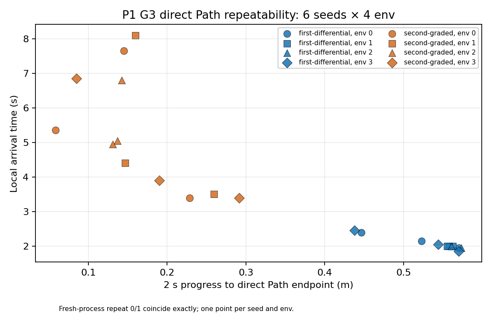

# P1 G3 direct Path反復：48 trial結果（2026-10-12）

## 判定と適用範囲

凍結済み`eatnav_p1_longhorizon_g3_direct_repeat_v1`の **12/12 process・48/48 direct trialがprotocol-valid**。既存pilotの4 trialを再実行せず採用し、残り11 processをassignment順に逐次実行した。全batchでpre-Path gate、4 follower、exact-stamp、same-episode、resource、native exit、cleanup、host/container SHA、host sealを通過した。各host sealは297ファイルでvalid。全trialがlocal arrivalし、censor・termination・reset・recoveryは0。今回の同一Pathの記述結果から、異なるPathの品質差や汎化性能は主張しない。

Raw traceと12 seal：`/home/kojima/eatnav-experiments/p1-long-horizon-v1/g3-direct-repeat-v1-attempt-0/`。凍結manifest SHA-256：`39b19cec76e03d0a15daa0e297229ef9c9a9e1325462d786c9d7e2248dd00874`。凍結集計JSON：`/home/kojima/eatnav-experiments/p1-long-horizon-v1/g3-direct-repeat-v1-continuation-attempt-1/direct-repeat-aggregate.json`、SHA-256 `b75aa65549ca25d186ea2c93542e99f490908b22ce303c170b2dd562b33fb3e3`。24件のseed×env測定値は[CSV](p1-g3-direct-repeat-unique-seed-env-20261012.csv)に、全48 trialとp95/peakは集計JSONに保存した。各seed×envのrepeat 0/1は測定値が一致するため、図は24点だけ表示する。

## StateGroup・seed・env別Outcome

CSVは各StateGroup×seed×env IDについて、2秒progress、arrival、tracking、recovery、接触force平均、絶対torque平均を列挙する。以下はseedごとの4 env平均。Trackingとbody loadはarrival前の曝露だけで計算し、stop holdを含めない。

| StateGroup | seed | 2秒progress平均 (m) | arrival平均 (s) | tracking平均 (m) | contact平均 (N) | 絶対torque平均 |
| :--- | ---: | ---: | ---: | ---: | ---: | ---: |
| first-differential | 2026101101 | 0.50185 | 2.2125 | 0.02654 | 7.88 | 186.55 |
| first-differential | 2026101102 | 0.56767 | 1.9375 | 0.02056 | 9.03 | 219.76 |
| first-differential | 2026101103 | 0.54568 | 2.0500 | 0.02263 | 8.66 | 209.00 |
| second-graded | 2026101111 | 0.15972 | 4.9875 | 0.03493 | 11.12 | 217.57 |
| second-graded | 2026101112 | 0.18299 | 5.0250 | 0.04062 | 13.06 | 190.17 |
| second-graded | 2026101113 | 0.15104 | 5.8250 | 0.05266 | 12.55 | 187.91 |

first-differentialの24 trialはprogress `0.438–0.573 m`、arrival `1.85–2.45 s`。second-gradedはprogress `0.058–0.291 m`、arrival `3.40–8.10 s`。2群の観測範囲は重ならない。これはStateGroup/terrain条件に沿った分離であり、同一条件内の二峰性を示すものではない。second-graded内部には広い連続的なばらつきが見えるが、3 seedでは挙動群数を確定できない。2秒progressが小さくても全trialは後で到達した。

Env IDによる一定方向の優劣は確認できない。progress最大envは6 seedで順に`1, 2, 2, 3, 1, 0`、最速arrival envも`1, 3, 1, 3, 1, 0`と変わる。group別env平均はCSVから計算できるが、env IDはtile配置・並列solver状態と結び付くため、それだけを原因と断定しない。

## 同一process内のdirect duplicate

各processのenv 0–1、2–3で **24ペア評価中6 Pass／18 Fail（25% Pass）**。first-differentialは6/12 Pass、second-gradedは0/12 Pass。fresh-process repeatが数値的に完全一致するため、独立なseed×pairとしては12 unique pair評価・3 Pass／9 Failであり、24ペアを独立標本とはみなさない。既存gate閾値は変更していない。Failはprotocol failureではなく有効Outcome。

| 絶対paired差 | 全24ペア中央値 | p90 | 最大 | first-differential中央値 | second-graded中央値 |
| :--- | ---: | ---: | ---: | ---: | ---: |
| 2秒progress (m) | 0.06078 | 0.12299 | 0.14920 | 0.02467 | 0.07848 |
| arrival (s) | 0.70 | 4.15 | 4.70 | 0.125 | 2.65 |
| tracking平均 (m) | 0.00723 | 0.04708 | 0.06555 | 0.00290 | 0.02223 |
| contact平均 (N) | 1.70288 | 3.97843 | 4.36125 | 1.11632 | 2.40153 |
| 絶対torque平均 | 17.33582 | 71.87436 | 110.36592 | 10.41352 | 33.49468 |

これらの中央値・p90・最大は**記述的repeatability benchmark**であり、p90を検出限界や95%検出保証とは扱わない。second-gradedでは特にarrival/tracking/contactのpair差が大きい。Recoveryは全48 trialで0のため、今回の条件でRecovery差は評価不能。

## Fresh-process repeatとterrain fingerprint監査

同一StateGroup・seed・env IDの24組について、Outcome列（progress、arrival、tracking、contact、torque、recovery）のrepeat差は全て**0**。さらに6 seed×4 envの全step列で、root/post-root、Actor入力/action、follower/applied command、contact force、Critic valueの最大絶対差も**0**で、各組のtrace長も一致した。したがって観測されたfresh-process数値再現性は完全だった。ただし、これは6 seed条件を2回ずつ実行した結果で、12の独立条件ではない。

Terrain canonical mesh SHAはStateGroup内で一致したが、記録された`material_sha256`は**12 processすべて異なる**。凍結集計器はmeshとmaterialの両SHA一致を厳格に要求するため、集計JSONの`fresh_process_matched_pairs=0`、`independent_condition_count=12`はその仕様どおりである。この値を黙って修正・統合していない。上記の24組は**seed/envで対応付けた探索的比較**であり、厳密なmaterial一致を証明したmatched pairではない。

静的ソース監査では、material SHAは`sha256(str(cfg.scene.terrain.physics_material))`から作られている（凍結simulator sourceの`material=`箇所）。Isaac Labの`RigidBodyMaterialCfg`は`func=spawn_rigid_body_material`を含むdataclassであり、その文字列表現にprocess依存の関数アドレスが入る可能性が高い。全repeatの物理・接触traceがbit相当で一致することも、SHA差を物理材料差と即断しない根拠となる。ただし実際のcomposed PhysX material属性の原本は今回保存しておらず、SHA差の全原因は確定していない。したがってmaterial SHAを無視した結果は探索的に留め、将来の候補Path比較前にはmaterial属性の安定したfingerprintを別versionで検証する必要がある。

## 将来のPath差を測る精度の探索的目安

今回はPath候補間効果を測っていない。比較の計画値として、各seed内の2 direct pairで`(env1−env0)`と`(env3−env2)`の**符号付き差を平均**し、3 seed間の標準偏差をStateGroupごとに計算した。first-differentialではprogress `0.0080 m`・arrival `0.038 s`、second-gradedではprogress `0.0932 m`・arrival `3.307 s`。各groupでn=3 seedしかないうえ、2 pair間の符号相殺もあり得るため、このSDは不安定で候補Pathの真のpaired effect分散を代替しない。

あくまでsecond-gradedの上記SDを固定した**計算例**として、独立seedを実験単位とする正規近似`n≈((1.96+0.84)×SD/効果)^2`を使うと、progress差`0.10 m`に約7 seed、`0.05 m`に約28 seed、arrival差`2 s`に約22 seedとなる。これは事前のsample-size決定や検出保証ではない。material fingerprintの解決、候補割当のbalance、実際の候補−direct paired差のpilot測定を経て再推定する必要がある。現状で単一process・単一env pairの小差を品質差と判定するのは難しい。

## 実行管理・resource・保存

12 processのhost wall合計は**818.37 s**（承認後に実行した11件は766.07 s）、個別範囲`49.36–90.24 s`で600秒cap内。GPU device-total peak **5,195.25 MiB**（cap 7,680）、owned attribution gap peak **108.85 MiB**（cap 256）、container anon+shmem peak **3,565,785,088 B**（cap 6,442,450,944）、active per-process storage peak **24,583,271 B**（cap 1,000,000,000）。データrootの最終ファイル合計は**208,472,604 B**。native exitは全12件0、owned residualは0、外部Zenoh router・production follower・checkpointは変更していない。

最初の逐次管理attemptは、2件目の正常終了時に最後のGPU sampleのPID消失を追加checkerが一律Failと解釈して停止した。2件目自体はhost monitorによりcomplete marker、native exit 0、cleanup、sealを確認したprotocol-valid測定であり、再実行していない。旧管理status/sourceは元data rootに保存した。新管理root`g3-direct-repeat-v1-continuation-attempt-1`に修正理由、旧/新source SHA、synthetic確認、ログ、statusを分離保存し、3件目から再開した。新checkerは**最後の1 sampleのみ**を凍結host monitorと同じ条件で分類し、非terminalのPID消失・native exit異常・resource超過を引き続き拒否する。Simulator/hostの凍結source SHAや数値gateは変更していない。

## 結論

この実験系ではfresh-process再実行の数値Outcomeは完全再現した一方、**異なるenvで同じPathを走らせると、特にsecond-gradedで大きな差**が出た。現データは将来のcandidate Path比較に必要なばらつきの下調べとして有効だが、material fingerprintの不安定さとseed数3/groupにより、統計的検出力・候補品質の識別可能性はまだ確定できない。ここで停止し、curved Path、Evaluator学習、full collectionには進まない。
