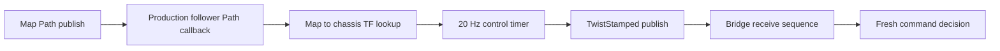
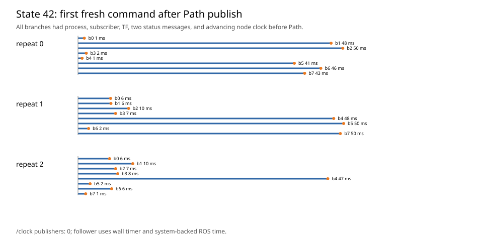
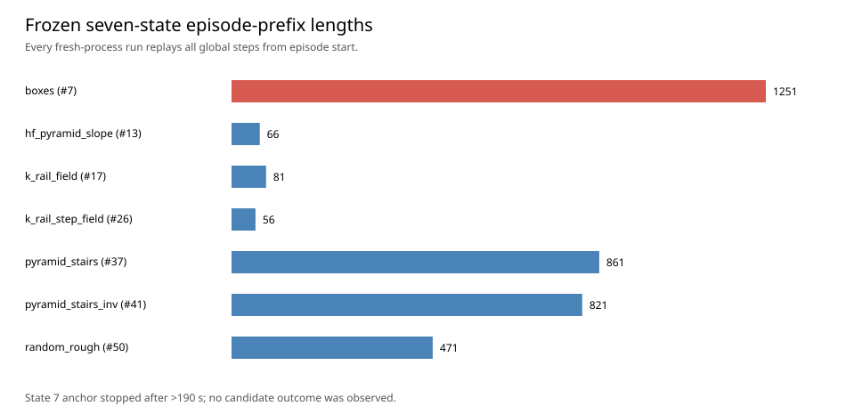

# EAT-Nav feasible-set: State 42 diagnosis and seven-terrain pilot stop

Date: 2026-09-29. This report preserves the first seven-terrain pilot attempt. It stopped at the user-defined unexpected-runtime condition before any pilot candidate outcome was observed. The frozen state list and prior diagnostic artifacts were not changed.

## State 42 classification

**Valid after bridge-only readiness repair.** The frozen Path began at `(-0.0694, -0.1863)` and ended at `(-0.1756, 0.6066)` in `map`; the goal was 0.8000 m away. The production follower's goal tolerance is 0.2 m. Its goal-hold branch would publish a fresh zero `TwistStamped`, whereas the original failure had **no message** in any of eight bridge sequences for the two-second wait. A normal goal-tolerance stop is excluded.

The original eight follower logs show the Path callback and initial `map → branch_i/chassis/body` TF lookup warning, then later control output. The old bridge returned from reset on subscriber discovery alone and did not establish TF, timer or first-command readiness. In a simulator-load reproduction, branch 0 delivered its first command **after** reset returned. The exact last missing boundary during the original timeout cannot be reconstructed because the old bridge did not timestamp each publish and receive event; the startup-readiness race is established by the bridge control flow and the reproduction.

A separate reset contamination was also found: transient-local publishers retained the previous Path, so a newly spawned follower could start issuing commands **before the next Path was published**. The affected intermediate retest is preserved and excluded. The bridge now publishes an empty retained Path before spawning followers, ignores pre-Path or older-stamped commands, then waits for all eight processes, subscribers, TF lookups and two follower status-timer messages. After Path publication it waits for a fresh command from every branch; one identical Path resend is allowed within fixed timeouts. The follower control law, parameters, dynamics and simulator settings were not changed.

There is no `/clock` publisher in this runtime and `use_sim_time` is false. The follower uses `create_wall_timer`; the bridge therefore verifies two advancing **system-backed ROS node clock** intervals. This is a documented deviation from the literal `/clock`-message criterion, which cannot pass in the current runtime. [Readiness evidence](readiness-handshake.json) records the zero publisher count and samples. The production follower does not expose exact control-timer callback or command-publish counters. [Boundary counts](follower-boundary-counts.json) keep the observable Path callbacks, throttled control-log lower bounds and exact bridge receive sequences; unavailable exact counts are marked `null` rather than inferred.

Three clean fresh-process State 42 repeats each completed 40 control steps and yielded 41 fresh bridge responses. All had zero pre-Path sequences, eight post-Path fresh commands, no Path resend, matching anchor critical fields, matching fixed Path SHA and command series. Duplicate XY RMS was **0.0000 m**, below 0.0105 m. Individual markers, traces and timing are in [state42-retest.json](state42-retest.json) and `state42-retest-v2-raw/`.

## Frozen seven-terrain selection

The selection was computed from the existing 56 train states, using SHA256 rank, one episode per selected state, and relative-goal distance at least 0.30 m. No proposal outcome, termination or Critic result entered selection. Selection and candidate order were frozen before the pilot process started in [pilot-state-selection.json](pilot-state-selection.json), [pilot-config.yaml](pilot-config.yaml) and [pilot-input-freeze.json](pilot-input-freeze.json).

| Terrain | State | Global anchor step | Episode key |
|---|---:|---:|---|
| boxes | 7 | 1250 | `[0,52,3]` |
| hf_pyramid_slope | 13 | 65 | `[0,88,0]` |
| k_rail_field | 17 | 80 | `[0,59,0]` |
| k_rail_step_field | 26 | 55 | `[0,51,0]` |
| pyramid_stairs | 37 | 860 | `[0,75,2]` |
| pyramid_stairs_inv | 41 | 820 | `[0,72,2]` |
| random_rough | 50 | 470 | `[0,50,1]` |

## Pilot stop

The first selected state, boxes #7, requires episode-prefix replay through global step 1250 **for every fresh simulator process**. Its first anchor had exceeded **190.0 s** without a completion marker when stopped. For comparison, the prior State 42 anchor at step 60 completed in **57.34 s**. The first anchor thus exceeded 3.31 times that measured time before completion. The frozen schedule would require 32,463 replayed prefix steps across seven anchors, three nominal repeats and five candidates per state. The earlier per-run timing estimate did not account for this long-prefix distribution.

This is an **unexpected runtime increase**, so the pilot was stopped under the specification's stop rule. No candidate-specific Path was evaluated, no seven-terrain duplicate or feasibility result exists, and no state was replaced. The interrupted anchor has no completion marker and is not treated as a measurement-invalid trajectory. [pilot-feasibility.json](pilot-feasibility.json) marks all seven outcomes `NA`; [pilot-decision.json](pilot-decision.json) records the runtime stop. The observed GPU memory sample was 5370 MiB, not a peak measurement. Host artifacts occupied about 23.4 MB at stop; no candidate storage rate can be estimated yet. See [runtime-storage.json](runtime-storage.json).

The requested terrain duplicate-RMS, duplicate-versus-effect, 40-step command, maneuver-progress and feasibility figures have no pilot observations to plot. The two figures above show only the completed State 42 timing and the fixed prefix-cost issue.

## Gate and next decision

State 42 infrastructure gate: **pass**. Seven-terrain pilot measurement and feasible-set gate: **pending; stopped before outcomes due to runtime**. Formal 56-train and 20-validation rollouts, Phase D/E, full collection and robot trials were not started. No model, loss, maneuver bank, Path formula, follower controller or state-selection threshold was changed.

Continuing with the *same frozen seven states* requires accepting a longer runtime budget and measuring one full state #7 fresh-process run before scheduling the remaining cases. A revised cost-aware state-selection rule would require a new pre-outcome freeze; within the current 56 train states, boxes has only one state beyond the 0.30 m goal threshold, and it is #7 at global step 1250. Either path needs a new explicit decision because this run met the specified stop condition.
